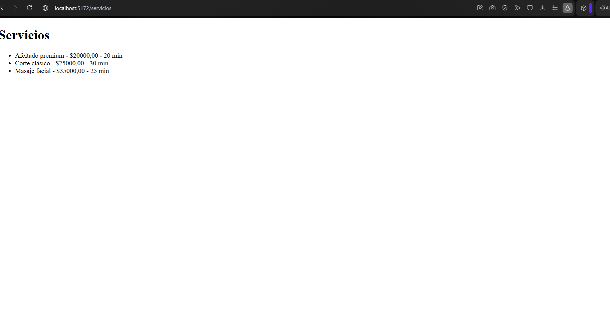

# Barber club

Plataforma web para que los clientes de una barbería reserven su cita en línea eligiendo servicio, barbero, fecha y hora. Los barberos consultan su agenda y el administrador gestiona servicios, barberos y reservas. Proyecto de Programación Web (IF2003), grupo 603. Equipo 05.



**Dirección pública:** COMPLETAR (dirección de Azure App Service)

## Integrantes

| Nombre | Usuario de GitHub |
|---|---|
| Victor Cardenas | @VictorCardenass |
| Gledier Luis Ortiz Perez | @gledierluis20 |
| Jhorman Puerta | @jhormanpuerta2007-cmd |

## Tecnologías

- ASP.NET Core MVC con Razor, .NET SDK 10.0.302
- Entity Framework Core con PostgreSQL (Npgsql) y migraciones
- API REST documentada con OpenAPI, consumida desde el frontend con `fetch`
- Publicación en Azure App Service con GitHub Actions

## Cómo ejecutarlo en local

**Requisitos**

- .NET SDK 10.0.302 (`dotnet --version` debe mostrar un número que empiece por `10.`)
- Git
- PostgreSQL 18 corriendo en `localhost:5432`
- Herramienta de Entity Framework: `dotnet tool install --global dotnet-ef --version 10.*`

**Pasos (PowerShell)**

```
git clone https://github.com/VictorCardenass/actividad-seg-01-05.git
cd actividad-seg-01-05
Copy-Item appsettings.example.json appsettings.Development.json
dotnet restore
dotnet ef database update
dotnet run
```

El archivo `appsettings.Development.json` no viene en el repositorio, porque la configuración y los secretos no se suben a Git. Se crea a partir de la plantilla con el `Copy-Item` de arriba. Sin ese paso, `dotnet ef database update` falla con el error `The ConnectionString property has not been initialized`.

La plantilla trae la cadena de conexión `BarberClub` apuntando a `localhost`, con el usuario `postgres` y sin contraseña. Si tu PostgreSQL local exige contraseña, agrégala solo en tu archivo `appsettings.Development.json` (con `Password=...`), nunca en la plantilla.

`dotnet ef database update` crea la base `barber_club`, sus tablas y los datos de ejemplo. Abre la dirección que imprima la terminal (normalmente `http://localhost:5172`).

| Ruta | Qué muestra |
|---|---|
| `/servicios` | Lista de servicios |
| `/catalogo` | Catálogo cargado con `fetch` desde la API |
| `/reservas/nueva` | Formulario para crear una reserva |
| `/reservas/mias` | Consulta de reservas por teléfono |
| `/api/servicios` | API de servicios (JSON) |
| `/openapi/v1.json` | Documentación OpenAPI |

## API REST

La API permite consultar los servicios y barberos disponibles, consultar horarios libres y gestionar reservas.

La documentación OpenAPI está disponible en:

`http://localhost:5172/openapi/v1.json`

### Endpoints

| Método | Ruta | Descripción |
|---|---|---|
| GET | `/api/servicios` | Lista los servicios activos. |
| GET | `/api/servicios/{id}` | Consulta un servicio activo por su ID. |
| GET | `/api/barberos` | Lista los barberos activos. |
| GET | `/api/reservas/horarios-libres?barberoId=1&fecha=2026-11-30` | Consulta los horarios libres de un barbero en una fecha. |
| POST | `/api/reservas` | Crea una reserva si el horario está disponible. |
| DELETE | `/api/reservas/{id}?telefono=3001234567` | Cancela una reserva verificando el teléfono registrado. |

### Códigos de respuesta

- `200 OK`: consulta realizada correctamente.
- `201 Created`: reserva creada correctamente.
- `204 No Content`: reserva cancelada correctamente.
- `400 Bad Request`: datos inválidos o parámetros requeridos ausentes.
- `404 Not Found`: servicio o reserva no encontrados.
- `409 Conflict`: horario ocupado o reserva en conflicto.

### Ejemplo para crear una reserva

Solicitud `POST /api/reservas` con contenido JSON:

```json
{
  "servicioId": 1,
  "barberoId": 1,
  "inicio": "2026-11-30T10:00:00",
  "nombreCliente": "Juan Pérez",
  "telefono": "3001234567"
}
```

La API responde con código `201 Created` y los datos de la reserva creada.

### Ejemplo para cancelar una reserva

Solicitud:

`DELETE /api/reservas/1?telefono=3001234567`

Si el teléfono coincide con el registrado, responde `204 No Content`.

## Usuarios de ejemplo

Usuarios de demostración que se crean automáticamente al arrancar la aplicación. Son solo para probar los roles; no deben usarse en un entorno real.

| Rol | Correo | Contraseña |
|---|---|---|
| Cliente | cliente@barberclub.com | Cliente123! |
| Barbero | barbero@barberclub.com | Barbero123! |
| Administrador | admin@barberclub.com | Admin123! |

## Configuración por entornos

| Elemento | Local | Producción |
|---|---|---|
| Base de datos | PostgreSQL en el computador del desarrollador | PostgreSQL en la nube de Azure |
| Cadena de conexión | `appsettings.Development.json` (excluido de Git) | Configuración de la aplicación en Azure, con el nombre `BarberClub` |
| Publicación | No aplica | Automática al integrar a `main` |

## Documentación del proyecto

Ver [docs/definicion.md](docs/definicion.md) para el documento completo de definición, con el mockup en `docs/mockup/` y la presentación en `docs/presentacion/`.