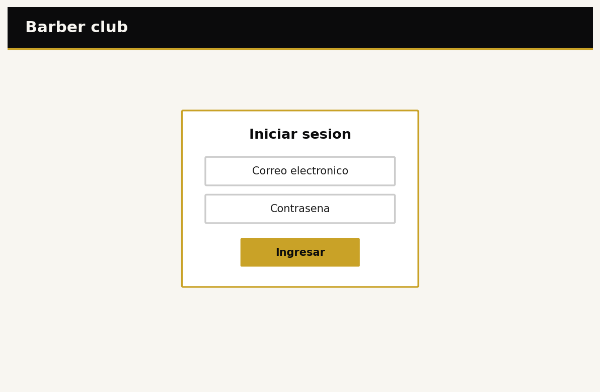
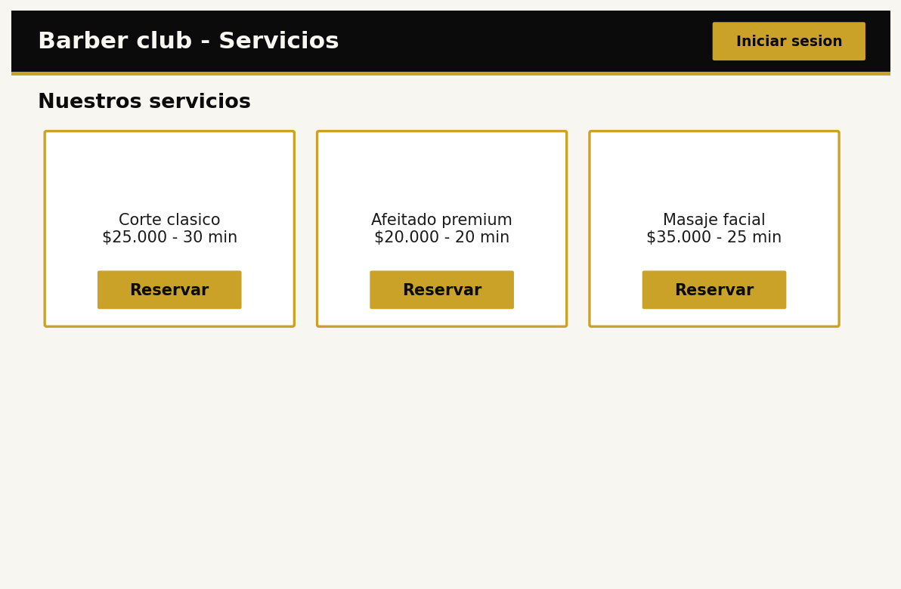
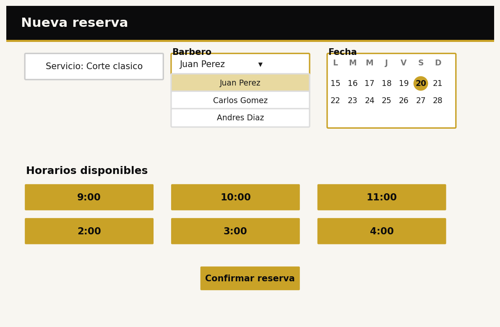
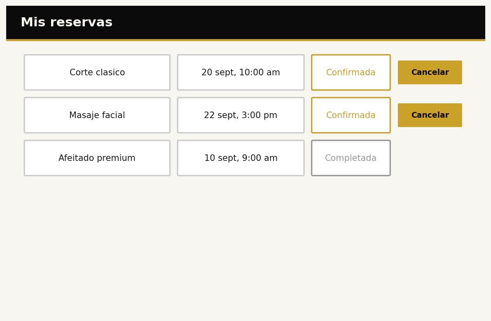
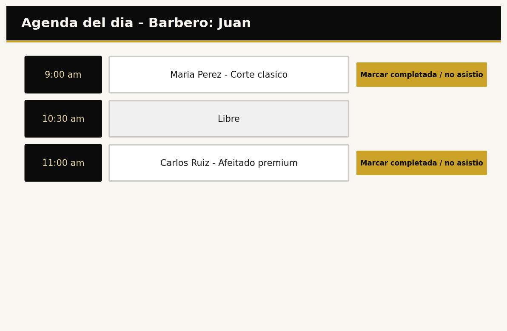
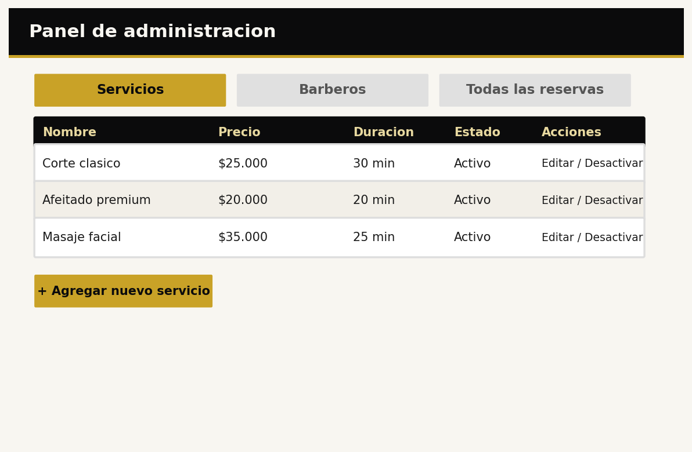

# Definición del proyecto: Barber club

Programación Web (IF2003), grupo 603. Equipo 05.

## 1. Descripción general

Barber club es una plataforma web para que los clientes de una barbería reserven su cita en línea, eligiendo el servicio, el barbero, la fecha y la hora que prefieran, sin necesidad de llamar o desplazarse hasta el local. Los barberos consultan su agenda del día directamente en la plataforma. El administrador gestiona los servicios que ofrece la barbería, los barberos disponibles y tiene visibilidad completa sobre todas las reservas del negocio.

## 2. Problema

Actualmente las citas de la barbería se agendan por teléfono o WhatsApp, escribiendo el nombre del cliente en una libreta o dejándolo en el chat. Esto genera al menos dos problemas concretos: primero, se presentan cruces de horario porque dos personas distintas pueden agendar la misma hora con el mismo barbero sin que nadie lo note a tiempo; segundo, un cliente no tiene forma de saber qué horarios están disponibles sin llamar o ir en persona a preguntar.

## 3. Objetivos

**General:** permitir que un cliente reserve una cita en la barbería sin necesidad de llamar o desplazarse al local.

- Eliminar los cruces de horario: ningún barbero tiene dos citas confirmadas en el mismo horario.
- Permitir que un cliente complete una reserva en menos de dos minutos.

## 4. Stakeholders, actores y roles

- **Cliente** (rol): consulta servicios y disponibilidad, reserva una cita indicando su nombre y teléfono, y consulta y cancela sus reservas con ese teléfono.
- **Barbero** (rol): consulta la agenda de un día. Modificado respecto al diseño inicial: el barbero no está enlazado a su cuenta de usuario, así que elige el barbero y la fecha y no se limita a su propia agenda. Solo acceden los roles Barbero y Administrador.
- **Administrador** (rol): gestiona los servicios y los barberos, y ve todas las reservas del negocio.
- **Dueño de la barbería** (stakeholder): no necesariamente usa la plataforma a diario, pero es el dueño del negocio que se beneficia de organizar las citas.
- **Login:** el administrador y el barbero inician sesión con correo y contraseña. Los clientes no necesitan cuenta para reservar.

## 5. Alcance

**Incluye:** consulta de servicios y disponibilidad, reserva de citas por parte del cliente, cancelación de reservas propias, agenda del barbero, gestión de servicios y barberos por el administrador, inicio de sesión con tres roles.

**No incluye:** pagos en línea, notificaciones automáticas por mensaje de texto o correo, aplicación móvil nativa, sistema de reseñas o calificaciones, bloqueo de horarios por parte del barbero, reservas ligadas a una cuenta de cliente y marcar las citas como completadas o no asistidas.

## 6. Funcionalidades

 - **Cliente:** ver servicios y su disponibilidad, reservar una cita eligiendo servicio, barbero, fecha y hora, y ver, editar y cancelar sus reservas con su teléfono.
- **Barbero:** ver la agenda de un día, eligiendo el barbero y la fecha. Modificado respecto al diseño inicial: la agenda no se limita al barbero que inició sesión, porque el barbero no está enlazado a su cuenta de usuario. Solo acceden los roles Barbero y Administrador.
- **Administrador:** gestionar servicios y barberos, y ver todas las reservas del negocio.

## 7. Requerimientos funcionales

| ID | Requerimiento | Rol | Prioridad | Estado | Razón |
|---|---|---|---|---|---|
| RF-01 | El sistema debe permitir reservar una cita indicando servicio, barbero, fecha y hora. | Cliente | Alta | Modificado | Se reserva sin iniciar sesión, con nombre y teléfono del cliente, para que reservar no exija crear una cuenta. |
| RF-02 | El sistema no debe permitir dos citas confirmadas sobre el mismo barbero en el mismo horario. | Todos | Alta | Implementado | Lo valida el servicio de reservas y lo respalda un índice único en la base de datos. |
| RF-03 | El sistema debe permitir al barbero marcar una cita como completada o no asistida. | Barbero | Media | Recortado | Prioridad media. El barbero solo consulta su agenda. |
| RF-04 | El sistema debe mostrar al cliente la lista de sus reservas y permitirle cancelarlas. | Cliente | Alta | Modificado | Las reservas se consultan por teléfono. Cancelar elimina la reserva y libera el horario. |
| RF-05 | El sistema debe permitir al administrador crear, editar y desactivar servicios. | Administrador | Alta | Implementado | Panel de servicios, solo para el rol Administrador. |
| RF-06 | El sistema debe permitir al administrador crear y editar barberos. | Administrador | Media | Implementado | Panel de barberos, solo para el rol Administrador. |
| RF-07 | El sistema debe permitir al administrador ver todas las reservas del negocio. | Administrador | Alta | Implementado | Vista de todas las reservas, solo para el rol Administrador. |

## 8. Requerimientos no funcionales

| ID | Categoría | Requerimiento |
|---|---|---|
| RNF-01 | Rendimiento | La lista de servicios y disponibilidad carga en menos de 2 segundos con conexión estable. |
| RNF-02 | Seguridad | Las contraseñas se guardan cifradas, nunca en texto plano. Cada rol solo accede a las funciones que le corresponden. |
| RNF-03 | Usabilidad | La plataforma se ve y se usa bien desde un ancho de 360 px. |
| RNF-04 | Compatibilidad | Funciona en las versiones vigentes de Chrome, Edge y Firefox. |

## 9. Reglas de negocio

- RN-01. **Modificada.** Cada cita ocupa un cupo fijo de una hora, de 9:00 a 18:00, sin importar la duración del servicio elegido.
- RN-02. **Recortada.** No hay límite de citas activas por cliente en esta versión.
- RN-03. Un barbero no puede tener dos citas en el mismo horario. Implementada.
- RN-04. Un servicio desactivado no aparece disponible para reservar, pero conserva su historial de citas asociadas. Implementada.

## 10. Modelo de datos

| Entidad | Atributos principales |
|---|---|
| Usuario | Id, Nombre, Correo (único), PasswordHash (contraseña cifrada), Rol (Cliente, Barbero o Administrador) |
| Barbero | Id, Nombre, Activo |
| Servicio | Id, Nombre, Precio, Duracion (minutos), Activo |
| Reserva | Id, ServicioId, BarberoId, Inicio (fecha y hora), NombreCliente, Telefono, Estado (hoy siempre Activa: cancelar elimina la reserva) |

**Relaciones:** cada reserva pertenece a un servicio y a un barbero, y un servicio o un barbero tienen muchas reservas. La base de datos tiene un índice único sobre barbero e inicio, así que no admite dos reservas del mismo barbero a la misma hora. Usuario no se relaciona con Barbero ni con Reserva: la reserva guarda el nombre y el teléfono del cliente.

## 11. Pantallas y flujo

| Pantalla | Rol | Para qué sirve |
|---|---|---|
| Inicio de sesión | Administrador y Barbero | Entrar con correo y contraseña. |
| Servicios y catálogo | Público | Ver los servicios ofrecidos. |
| Nueva reserva y reserva en línea | Público | Elegir servicio, barbero, fecha y hora, y confirmar. |
| Mis reservas | Público | Ver, editar y cancelar las reservas de un teléfono. |
| Agenda del barbero | Barbero y Administrador | Ver las citas de un día de cualquier barbero. Requiere iniciar sesión. |
| Paneles de administración | Administrador | Gestionar servicios y barberos, y ver todas las reservas. |

**Flujo del cliente:** servicios, nueva reserva, mis reservas.

**Flujo del barbero:** inicio de sesión, agenda del barbero.

**Flujo del administrador:** inicio de sesión, paneles de administración.

## 12. Mockup

*Los mockups son el diseño inicial. La plataforma final los simplifica: el cliente reserva sin iniciar sesión, la agenda del barbero no marca citas como completadas y cancelar elimina la reserva.*

*Formulario centrado con correo, contraseña y botón "Ingresar".*

*Tarjetas de servicio con nombre, precio, duración y un botón "Reservar".*

*Selector desplegable de barbero con nombres reales, un mini calendario para elegir la fecha, y franjas de hora disponibles.*

*Lista de citas del cliente con estado y botón "Cancelar" (solo en las que están confirmadas).*

*Vista de la agenda del día del barbero con el nombre del cliente y el servicio de cada cita, y el botón para marcarla como completada o no asistida.*

*Panel con pestañas para servicios, barberos y todas las reservas, con una tabla de ejemplo con datos reales de tres servicios.*

## 13. Historias de usuario, casos de uso, restricciones y supuestos

**Historia 1:** como cliente, quiero ver qué horarios están disponibles para un servicio, para reservar sin llamar a la barbería.

**Historia 2:** como barbero, quiero ver mi agenda del día, para saber qué citas tengo sin depender de que alguien más me avise. En la plataforma final el barbero elige el barbero y la fecha en la agenda, porque no está enlazado a su usuario.

**Historia 3:** como administrador, quiero ver todas las reservas del negocio, para tener control sobre la operación diaria.

**Caso de uso, reservar una cita.** Actor: cliente. Precondición: ninguna, no necesita iniciar sesión. Flujo: elige un servicio, elige un barbero, indica fecha y hora, escribe su nombre y teléfono, y confirma; el sistema guarda la reserva. Excepción: si el horario ya está reservado, el sistema rechaza la reserva y lo explica.

**Restricción:** sin pagos en línea ni notificaciones automáticas en esta versión.

**Supuesto:** se asume que cada barbero atiende un solo cliente a la vez.

## 14. Arquitectura, base de datos y API

**Entorno:** ASP.NET Core MVC (.NET 10), Entity Framework Core con PostgreSQL (Npgsql). **Carpetas:** `Controllers/`, `Models/`, `ViewModels/`, `Dtos/`, `Views/`, `Services/`, `Data/`, `Migrations/`. **Migraciones:** una por cambio del modelo, en `Migrations/`. **Servicios inyectados:** `ICatalogo` (implementación `CatalogoEf`) e `IReservas` (implementación `ReservasService`), registrados en `Program.cs` junto con `BarberClubDbContext`.

**Reglas de reserva:** los horarios son cupos de una hora, de 9:00 a 18:00. No se repite barbero y hora: lo valida `ReservasService` y lo respalda un índice único en la base de datos.

**Acceso y roles:** inicio de sesión con cookies y contraseñas cifradas con `PasswordHasher` de ASP.NET Core. Hay tres roles (Cliente, Barbero y Administrador). Las rutas `/admin/servicios`, `/admin/barberos` y `/admin/reservas` exigen el rol Administrador en el servidor. Las reservas (`/reservas/...` y la API de reservas) no exigen sesión: el cliente se identifica con su teléfono.

**Manejo de errores:** `ErrorController` muestra una página para las rutas inexistentes (404) y otra para los fallos del servidor (500). Las rutas que empiezan por `/api` no usan páginas HTML. Las listas vacías muestran un aviso.

**Modelo de datos:** ver la sección 10.

| Método | Ruta | Para qué sirve | Rol |
|---|---|---|---|
| GET | `/api/servicios` | Lista los servicios activos, ordenados por nombre. | Todos |
| GET | `/api/servicios/{id}` | Devuelve un servicio activo. Responde 404 si no existe o está inactivo. | Todos |
| GET | `/api/barberos` | Lista los barberos activos, ordenados por nombre. | Todos |
| GET | `/api/reservas/horarios-libres?barberoId=&fecha=` | Devuelve los horarios libres de un barbero en una fecha. Responde 400 si falta un dato. | Todos |
| POST | `/api/reservas` | Crea una reserva si el horario está libre. Responde 201, 400 si el dato es inválido o 409 si el horario está ocupado. | Todos |
| DELETE | `/api/reservas/{id}?telefono=` | Cancela una reserva, con el teléfono con el que se hizo. Responde 204, 400 o 404. | Todos |

La documentación OpenAPI está en `/openapi/v1.json`. Las páginas `/catalogo` y `/reservar` consumen la API con `fetch` y muestran un mensaje si falla la carga o si no hay datos.

## 15. Despliegue y configuración

| Elemento | Local | Producción |
|---|---|---|
| Dirección | `http://localhost:5172` | COMPLETAR: dirección pública de Azure App Service |
| Base de datos | PostgreSQL en el computador del desarrollador | PostgreSQL en un servicio en la nube de Azure |
| Cadena de conexión | Archivo local `appsettings.Development.json`, excluido de Git con `.gitignore`; la plantilla `appsettings.example.json` sí está en el repositorio | Cadena de conexión `BarberClub` en la configuración de la aplicación en Azure |
| Publicación | No aplica | Automática con GitHub Actions al integrar a `main` |

**Cómo ejecutar en local:** `dotnet restore`, `dotnet ef database update` y `dotnet run`. Ninguna clave ni cadena de conexión con contraseña se sube al repositorio.

## 16. Aportes por integrante

| Integrante | Aportes principales | Evidencia |
|---|---|---|
| Gledier Luis Ortiz Perez | Esqueleto ASP.NET, base de datos con EF Core y migración inicial, API de servicios con OpenAPI, páginas de error, API de reservas con horarios libres, crear y cancelar, página `/reservar` con `fetch` y actualización del README. COMPLETAR: despliegue en Azure. | PR #9, #10, #11, #12, #16, #21 |
| Víctor | COMPLETAR | COMPLETAR |
| Jhorman Puerta Ramirez | Modelo de usuario con rol y migración, layout común con menú, pie y vistas parciales, login con cookies, contraseñas cifradas y usuarios de ejemplo, panel del administrador con CRUD de servicios protegido por rol, administración de barberos y vista de todas las reservas para el administrador. | PR #14, #15, #17, #18, #20 |

## Historial de cambios

| Fecha | Qué cambió | Quién |
|---|---|---|
| 2026-09-15 | Version inicial del documento de definicion | Equipo 05 |
| 2026-09-16 | El equipo revisó el borrador y decidió quitar la funcionalidad de bloqueo de horarios por parte del barbero; se ajustaron las secciones 1 a 13 y las imagenes del mockup 03 y 06 para mostrar contenido real en vez de marcadores genericos | Equipo 05 |
| 2026-09-22 | Se completaron las referencias | Equipo 05 |
| 2026-09-23 | Se preparo la presentacion (docs/presentacion/) con la parte no tecnica y la parte tecnica | Equipo 05 |
| 2026-09-26 | Correcciones del profesor: se corrigio el formato de la bitacora, el enlace roto del README, y se incrustaron las imagenes del mockup dentro de este documento | Equipo 05 |
| 2026-11-27 | Se completaron las secciones 10, 14 y 15 con el modelo de datos final, los endpoints de la API y la configuración de despliegue | Gledier |
| 2026-11-27 | Se actualizaron las secciones 4, 5, 6, 7, 9, 11 y 13 con el estado de cada requerimiento (implementado, modificado o recortado) para que coincidan con la plataforma | Equipo 05 |
## Referencias

- Square, "Cómo mejorar la gestión de reservas de una peluquería". Describe cómo las reservas dobles y los solapamientos de agenda afectan la relación con el cliente. Usada para respaldar la sección 2 (Problema) y el requerimiento RF-02 (no permitir dos citas sobre el mismo barbero en el mismo horario). Enlace: https://squareup.com/es/ca/townsquare/mejorar-sistema-de-reservas-peluqueria
- OWASP Cheat Sheet Series, "Password Storage Cheat Sheet". Buenas prácticas para el almacenamiento cifrado de contraseñas. Usada para respaldar el requerimiento RNF-02 (seguridad). Enlace: https://cheatsheetseries.owasp.org/cheatsheets/Password_Storage_Cheat_Sheet.html
- MDN Web Docs, "Responsive design". Principios de diseño responsivo para que una interfaz funcione en anchos de pantalla pequeños. Usada para respaldar el requerimiento RNF-03 (usabilidad desde 360 px). Enlace: https://developer.mozilla.org/es/docs/Learn/CSS/CSS_layout/Responsive_Design

## Declaración de uso de inteligencia artificial

**Gledier Luis Ortiz Perez:** usé un asistente de IA (Claude) como apoyo en tres partes del proyecto. Le pedí un primer borrador del documento de definición a partir del problema, los roles y el flujo que el equipo ya había decidido; después de revisarlo con Víctor y Jhorman, le pedí quitar la funcionalidad de bloqueo de horarios (decisión del equipo) y ajustar las secciones afectadas. También le pedí generar las imágenes del mockup según las pantallas que definimos, y las diapositivas de la sustentación con lenguaje sencillo. El problema, los objetivos, las reglas de negocio y las decisiones de diseño (por qué 3 roles, por qué quitar el bloqueo de horarios) los decidimos nosotros; la IA fue apoyo para redactar y generar contenido visual, no quien definió el proyecto.
En la segunda etapa, durante el desarrollo de la plataforma,usé Claude y Chatgpt como guía paso a paso para construir y entender mi parte del código la base de datos con Entity Framework Core y PostgreSQL, la API de servicios y de reservas con OpenAPI. Ejecuté y probé en mi equipo cada bloque que me dio, y cuando algo falló le pegué el error para diagnosticarlo.

**[Victor Manuel Cardenas Benitez]:** Usé IA (Claude) en forma de guía y apoyo para revisar si el flujo planteado para los roles de cliente, barbero y administrador era coherente y para recibir sugerencias sobre qué aspectos podrían mejorarse. También lo utilicé como apoyo para revisar los mockups, identificar posibles elementos que faltaran y recibir recomendaciones sobre su organización. Las decisiones finales sobre el flujo, los roles, las funcionalidades y el diseño de los mockups fueron tomadas por el equipo.

**Jhorman Puerta Ramirez:** Usé IA (Claude) para resolver dudas sobre el manejo de GitHub, principalmente sobre los comandos de como commit, push, pull y la sincronización de las ramas. También lo utilicé como guía para solucionar problemas que aparecieron durante el proceso de subir y actualizar los cambios en GitHub, durante el desarrollo de la plataforma también lo usé como guía paso a paso para construir y entender mi parte (login con roles, protección de rutas, layout con vistas parciales y panel del administrador). Me sirvió para aclarar dudas sobre cómo funcionan las cookies de sesión, el cifrado de contraseñas con PasswordHasher, los roles y las vistas parciales, para resolver unos errores que aparecieron en el menú, y para entender la lógica del código que entregué. Los cambios realizados en el proyecto y las decisiones fueron tomadas por el equipo, probé cada bloque en mi equipo, la IA fue un apoyo para orientarnos en GitHub y para entender y resolver mi parte del código.
